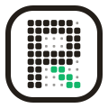

<div align="center">

<picture>
  <source media="(prefers-color-scheme: dark)" srcset="assets/brand/rulebox-mark-dark.svg">
  
</picture>

# Rulebox

**Only what you allow.**

Turn any Windows PC into a simple, locked PC that shows only the apps you choose.

[](LICENSE)


[What it is](#what-it-is) · [Screenshots](#screenshots) · [How it works](#how-it-works) · [Development](#development) · [Docs](#docs)

</div>

---

## What it is

Rulebox turns any Windows PC into a simple, locked PC that shows only the
apps you choose. It does this by adding a separate user to Windows for the
people using the PC, so your own Windows account stays exactly as it is, and
you can sign in to it and use the PC normally anytime. Everything is managed
from one web dashboard.

Use it for staff PCs in your store or office, classroom and lab computers, a
kids' PC at home, reception or self-service kiosks, or shared PCs in
libraries and cafés.

> [!NOTE]
> Rulebox is in early development and is not ready for real PCs yet.
> See [Status](#status).

## Screenshots

Coming soon. Screenshots of the sign-in screen, the desktop and the
dashboard will go here once those screens are built.

<!--
When screenshots exist, save them in docs/screenshots/ and replace the text above:

<p align="center">
  
  
</p>
-->

## Features

- **Only approved apps.** People see a clean desktop, taskbar and Start menu
  with the apps, websites and files you allow, and nothing else.
- **Your Windows stays yours.** Rulebox runs in its own Windows user. Your
  account, files and settings are not touched, and you can return a PC to
  normal Windows at any time.
- **One dashboard for every PC.** Group PCs, manage people, add or remove
  apps and install them remotely. Changes reach every affected PC
  automatically.
- **Sign in anywhere.** Each person signs in on any enrolled PC with their
  own details and gets their own files.
- **Works offline.** Each PC keeps its last known rules, so it stays locked
  and usable without internet.
- **Built for modest hardware.** Runs on 4 GB RAM laptops, with a Lite mode
  that turns off blur and motion.
- **Your brand, your backend.** Set your own name, logo, colors and
  wallpaper, and run it on your own Convex deployment.

## How it works

Rulebox has three parts:

| Part | What it does | Built with |
|---|---|---|
| **Dashboard** | The website where you manage PCs, people, apps and rules | Vite, React, TypeScript, Convex |
| **Agent** | A background Windows service on each PC that applies your rules and installs apps | Rust |
| **Staff App** | The locked desktop people see: sign-in, desktop, taskbar, Start menu and file viewer | Tauri v2, React |

You change something in the dashboard, the agent on each PC picks it up over
a live connection and applies it, and the Staff App shows the result. The
Staff App has no admin rights; anything privileged goes through the agent.

## Status

Rulebox is being built in phases. Version 1 targets Windows; Android is
planned for version 2.

| Phase | What | State |
|---|---|---|
| 1 | Project setup: dashboard, Staff App, backend schema and design system | Done |
| 2 | Agent: enrollment, Staff account, shell replacement | Planned |
| 3 | Staff App: sign-in, desktop, taskbar, Start menu, files | Planned |
| 4 | Dashboard: devices, people, groups, apps, remote installs | Planned |
| 5 | Lockdown and security checks | Planned |
| 6 | Installer and pilot on real PCs | Planned |

Details are in [`docs/plans/`](docs/plans/README.md).

## Development

You need Windows 10 or 11, [Node.js](https://nodejs.org) 22 or newer,
[pnpm](https://pnpm.io) and [Rust](https://rustup.rs).

```powershell
git clone https://github.com/zubairbinshaukat/rulebox.git
cd rulebox
pnpm install
```

| Command | What it does |
|---|---|
| `pnpm dev:convex` | Start the Convex backend |
| `pnpm dev:dashboard` | Run the dashboard |
| `pnpm dev:staff` | Run the Staff App (Tauri) |
| `pnpm typecheck` | Type-check all TypeScript |
| `pnpm lint` | Lint all apps |
| `pnpm gen:types` | Generate TypeScript types from the Rust policy types |
| `pnpm gen:brand` | Rebuild the logo files in `assets/brand/` |

> [!WARNING]
> Never test lockdown features (accounts, policies, shell replacement) on
> your own PC. Use a virtual machine or a spare test PC.

### Project layout

```
apps/
  dashboard/    Web dashboard
  staff-app/    Staff App (Tauri shell)
  agent/        Windows service (Rust)
convex/         Backend functions and schema
crates/         Shared Rust code
packages/
  ui/           Design system: tokens, components, logo and its animations
  types/        Generated TypeScript types
assets/brand/   Logo files (SVG, PNG, ICO)
docs/           Product spec and phase plans
```

## Docs

- [Product spec (PRD)](docs/prd.md)
- [Phase plans](docs/plans/README.md)
- [Third-party notices](THIRD_PARTY_NOTICES.md)

## License

Rulebox is open source under the [MIT License](LICENSE). Bundled third-party assets
keep their own licenses; see [THIRD_PARTY_NOTICES.md](THIRD_PARTY_NOTICES.md).
