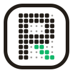

<div align="center">

<picture>
  <source media="(prefers-color-scheme: dark)" srcset="assets/brand/rulebox-mark-dark.svg">
  
</picture>

# Rulebox

**Only what you allow.**

Turn any Windows PC into a simple, locked PC that shows only the apps you choose.

[](LICENSE)


[What it is](#what-it-is) · [Screenshots](#screenshots) · [How it works](#how-it-works) · [Development](#development) · [Docs](#docs)

</div>

---

## What it is

Rulebox turns any Windows PC into a simple, locked PC that shows only the
apps you choose. It does this by adding a separate user to Windows for the
people using the PC, so your own Windows account stays exactly as it is, and
you can sign in to it and use the PC normally anytime. Everything is managed
from one web dashboard.

Use it for staff PCs in your store or office, classroom and lab computers, a
kids' PC at home, reception or self-service kiosks, or shared PCs in
libraries and cafés.

> [!NOTE]
> Rulebox is in early development and is not ready for real PCs yet.
> See [Status](#status).

## Screenshots

Coming soon. Screenshots of the sign-in screen, the desktop and the
dashboard will go here once those screens are built.

<!--
When screenshots exist, save them in docs/screenshots/ and replace the text above:

<p align="center">
  
  
</p>
-->

## Features

- **Only approved apps.** People see a clean desktop, taskbar and Start menu
  with the apps, websites and files you allow, and nothing else.
- **Your Windows stays yours.** Rulebox runs in its own Windows user. Your
  account, files and settings are not touched, and you can return a PC to
  normal Windows at any time.
- **One dashboard for every PC.** Group PCs, manage people, add or remove
  apps and install them remotely. Changes reach every affected PC
  automatically.
- **Sign in anywhere.** Each person signs in on any enrolled PC with their
  own details and gets their own files.
- **Works offline.** Each PC keeps its last known rules, so it stays locked
  and usable without internet.
- **Built for modest hardware.** Runs on 4 GB RAM laptops, with a Lite mode
  that turns off blur and motion.
- **Your brand, your backend.** Set your own name, logo, colors and
  wallpaper, and run it on your own Convex deployment.

## How it works

Rulebox has three parts:

| Part | What it does | Built with |
|---|---|---|
| **Dashboard** | The website where you manage PCs, people, apps and rules | Vite, React, TypeScript, Convex |
| **Agent** | A background Windows service on each PC that applies your rules and installs apps | Rust |
| **Staff App** | The locked desktop people see: sign-in, desktop, taskbar, Start menu and file viewer | Tauri v2, React |

You change something in the dashboard, the agent on each PC picks it up over
a live connection and applies it, and the Staff App shows the result. The
Staff App has no admin rights; anything privileged goes through the agent.

## Status

Rulebox is being built in phases. Version 1 targets Windows; Android is
planned for version 2.

| Phase | What | State |
|---|---|---|
| 1 | Project setup: dashboard, Staff App, backend schema and design system | Done |
| 2 | Agent: enrollment, Staff account, shell replacement | Planned |
| 3 | Staff App: sign-in, desktop, taskbar, Start menu, files | Planned |
| 4 | Dashboard: devices, people, groups, apps, remote installs | Planned |
| 5 | Lockdown and security checks | Planned |
| 6 | Installer and pilot on real PCs | Planned |

Details are in [`docs/plans/`](docs/plans/README.md).

## Development

You need Windows 10 or 11, [Node.js](https://nodejs.org) 22 or newer,
[pnpm](https://pnpm.io) and [Rust](https://rustup.rs).

```powershell
git clone https://github.com/zubairbinshaukat/rulebox.git
cd rulebox
pnpm install
```

| Command | What it does |
|---|---|
| `pnpm dev:convex` | Start the Convex backend |
| `pnpm dev:dashboard` | Run the dashboard |
| `pnpm dev:staff` | Run the Staff App (Tauri) |
| `pnpm typecheck` | Type-check all TypeScript |
| `pnpm lint` | Lint all apps |
| `pnpm gen:types` | Generate TypeScript types from the Rust policy types |
| `pnpm gen:brand` | Rebuild the logo files in `assets/brand/` |

> [!WARNING]
> Never test lockdown features (accounts, policies, shell replacement) on
> your own PC. Use a virtual machine or a spare test PC.

### Project layout

```
apps/
  dashboard/    Web dashboard
  staff-app/    Staff App (Tauri shell)
  agent/        Windows service (Rust)
convex/         Backend functions and schema
crates/         Shared Rust code
packages/
  ui/           Design system: tokens, components, logo and its animations
  types/        Generated TypeScript types
assets/brand/   Logo files (SVG, PNG, ICO)
docs/           Product spec and phase plans
```

## Run your own Rulebox backend

Rulebox runs on a [Convex](https://www.convex.dev) deployment that you own.
Do these steps once. Every command runs from the repo root in PowerShell.
Add `--prod` to a `convex` command to aim it at your production deployment.
The free Convex tier is enough to start.

> [!WARNING]
> Never set `RULEBOX_ALLOW_TEST_SEED` on a production deployment. It
> unlocks the test-data functions in `convex/testing.ts`, which are only for
> a throwaway dev deployment.

**1. Create the project and push the code**

```powershell
pnpm install
npx convex login
npx convex deploy
```

`npx convex deploy` asks you to create a project the first time. Copy the
deployment URL it prints (`https://<name>.convex.cloud`).

**2. Set up sign-in keys**

```powershell
npx @convex-dev/auth --prod
```

This creates the keys that sign member sessions and stores them in the
deployment's environment. Use the same tool without `--prod` for a dev
deployment.

**3. Create the first Owner**

```powershell
npx convex run setup:createOwnerInvite '{"orgName":"Acme","email":"you@example.com"}' --prod
```

It prints a one-time invite code. Open the dashboard at `/join`, enter the
code, choose a password, then set your action PIN (6 to 12 digits). You
need the PIN for sensitive actions and after the screen locks. Save the
recovery codes the dashboard offers.

**4. Create and register the policy signing key**

Policies sent to PCs are signed. The private key stays in your Convex
environment and the public key is registered in the dashboard.

```powershell
node scripts/policy-key.mjs generate --out .tmp/policy-key.seed
npx convex env set RULEBOX_POLICY_KEY (Get-Content .tmp/policy-key.seed -Raw).Trim() --prod
Remove-Item .tmp/policy-key.seed
```

Keep a private backup of the key (a password manager is fine); if you lose
it, PCs must be re-enrolled. Then, in the dashboard, open **Settings,
Signing** and register the key. No PC can enroll before you do this.
`node scripts/policy-key.mjs public --in <file>` prints the key id and public
key of an existing seed file.

**5. Deploy the dashboard**

Build it with your deployment URL:

```powershell
$env:VITE_CONVEX_URL = "https://<name>.convex.cloud"
pnpm --filter @rulebox/dashboard build
```

Upload `apps/dashboard/dist` to any static host. Single-page-app routing
(every path serves `index.html`) and the security headers matter:
`apps/dashboard/public/_headers` is ready for Cloudflare Pages (it is copied
into `dist`) and `apps/dashboard/vercel.json` for Vercel. On another host,
copy the same headers: a strict Content-Security-Policy, `X-Frame-Options:
DENY`, and `Referrer-Policy: no-referrer` on `/pin-reset`.

> [!NOTE]
> The dashboard reads its Convex URL from `/config.json` at start
> (`{ "convexUrl": "https://..." }`, placed next to `index.html`), so one build
> can serve several deployments. Without that file it uses `VITE_CONVEX_URL`
> from the build.

**6. Passkeys (optional but recommended)**

Passkeys let members confirm sensitive actions with a fingerprint or
security key. Set the web address of your dashboard:

```powershell
npx convex env set RULEBOX_WEBAUTHN_RP_ID dashboard.example.com --prod
npx convex env set RULEBOX_WEBAUTHN_ORIGINS https://dashboard.example.com --prod
npx convex env set RULEBOX_WEBAUTHN_RP_NAME "Acme Rulebox" --prod
```

`RULEBOX_WEBAUTHN_RP_ID` is the domain only. `RULEBOX_WEBAUTHN_ORIGINS` is
a comma-separated list of exact origins. `RULEBOX_WEBAUTHN_RP_NAME` is
optional (default `Rulebox`). Without the first two, passkeys are off.

**7. Recovery codes and forgot-PIN email**

Recovery codes need a server-side secret (at least 32 random characters):

```powershell
npx convex env set RULEBOX_RECOVERY_PEPPER (node -e "console.log(require('crypto').randomBytes(32).toString('base64'))") --prod
```

Without it, recovery codes cannot be created or used. To send "forgot PIN"
emails through [Resend](https://resend.com), store the mail settings as
encrypted platform secrets. Run this yourself, never through an automated
tool, because it handles a live API key:

```powershell
node scripts/platform-secret.mjs generate-key --out .tmp/platform.key
npx convex env set RULEBOX_PLATFORM_KEY (Get-Content .tmp/platform.key -Raw).Trim() --prod
node scripts/platform-secret.mjs set resendApiKey --key-file .tmp/platform.key --prod
node scripts/platform-secret.mjs set resendFrom --key-file .tmp/platform.key --prod
node scripts/platform-secret.mjs set dashboardOrigin --key-file .tmp/platform.key --prod
node scripts/platform-secret.mjs check --prod
```

Each `set` asks for the value. `resendFrom` looks like
`Rulebox <no-reply@your.domain>` and `dashboardOrigin` like
`https://dashboard.example.com`. Keep `.tmp/platform.key` somewhere safe
(you need it to change a secret later) and out of git. Until these are set
the forgot-PIN email is off.

**How a member who forgot their PIN gets back in**

1. **Email link** (needs step 7). On the lock screen, choose forgot PIN. The
   link goes to the signed-in member's own address and opens `/pin-reset`.
2. **Recovery code.** Use one of the codes saved earlier.
3. **Passkey.** Unlock with a passkey, then change the PIN in Settings.
4. **An Owner resets it.** The Owner removes the member's PIN and passkeys
   in **Settings, Members**. The member signs in again and sets a new PIN.
   An Owner cannot reset themselves (use 1 to 3) or a person who also
   belongs to another organization.

**8. Optional settings**

- `GITHUB_TOKEN`: a read-only GitHub token. It raises the rate limit when
  Rulebox looks up winget apps. Without it, lookups can fail when GitHub is
  busy. `npx convex env set GITHUB_TOKEN <token> --prod`
- **Ping interval.** How often idle PCs report in. The default is 30
  minutes; allowed values are 1 minute to 6 hours. Change it for everyone,
  or for one organization:

  ```powershell
  npx convex run plans:setGlobalPingInterval '{"pingIntervalMs":1800000}' --prod
  npx convex run plans:setOrgPingInterval '{"orgId":"<organization id>","pingIntervalMs":300000}' --prod
  npx convex run plans:setOrgPingInterval '{"orgId":"<organization id>","pingIntervalMs":null}' --prod
  ```

  The last command removes the organization's own value so it follows the
  global one again.
- `RULEBOX_HOSTED`: leave it unset when you run Rulebox for yourself. It is
  only for a shared, multi-customer deployment.

## Code signing policy

Release builds of Rulebox are built from this repository by GitHub Actions
([`release.yml`](.github/workflows/release.yml)) and published with a
`SHA256SUMS` file; see [Releasing Rulebox](docs/guides/release.md).

- **Today releases are unsigned.** Their file names end in `-unsigned`.
  Windows SmartScreen will warn when you run one. Check the download against
  `SHA256SUMS` and use unsigned builds on test or pilot PCs only.
- **Planned signing:** free code signing provided by
  [SignPath.io](https://signpath.io), certificate by
  [SignPath Foundation](https://signpath.org). This applies only once the
  application is approved; until then nothing here is signed.
- **What gets signed:** only the files built from this repository by the
  release workflow: `rulebox-agent.exe`, `rulebox-shell.exe`,
  `rulebox-staff.exe` and the MSI that contains them. Never apps that
  customers add to their PCs.
- **Roles:** the repository owner (GitHub: `zubairbinshaukat`) is the author,
  reviewer and approver of every signing request. Each request is made by the
  release workflow from a version tag; signing is never done from a developer
  PC.
- **Privacy:** Rulebox sends nothing to its authors. Each installation talks
  only to the Convex deployment its own administrator set up, and downloads
  only the installers and icons that administrator's signed policy names
  (plus Microsoft's WebView2 runtime when the PC lacks it).

## Docs

- [Product spec (PRD)](docs/prd.md)
- [Phase plans](docs/plans/README.md)
- [Releasing Rulebox](docs/guides/release.md)
- [Third-party notices](THIRD_PARTY_NOTICES.md)

## License

Rulebox is open source under the [MIT License](LICENSE). Bundled third-party assets
keep their own licenses; see [THIRD_PARTY_NOTICES.md](THIRD_PARTY_NOTICES.md).
